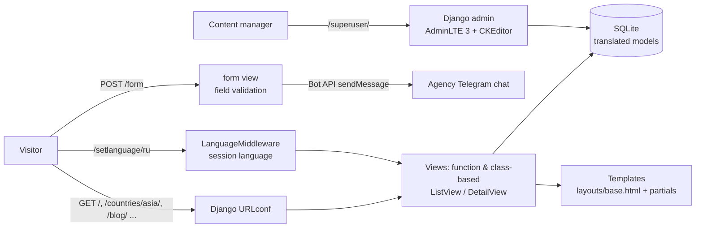

# Grants.uz — Study-Abroad Agency Website (Django)

**Multilingual (Uzbek / Russian / English) website for a study-abroad consulting agency: university catalogues by region, blog, gallery, branches, FAQ and a lead form that delivers applications straight to Telegram — all content managed from a themed Django admin.**


---

> **Credits.** This project is based on [Orifjon94/grant](https://github.com/Orifjon94/grant) by its original author.
> I maintain the site and made the redesign and further improvements: new templates and styles, configuration through environment variables, and secure Telegram lead delivery.

## Overview

Students who want to study abroad need to compare universities, tuition and conditions across many countries before contacting a consultant. This site gives the agency a catalogue of partner universities grouped by region (Asia & CIS, Europe, Oceania), editorial content (blog, FAQ, testimonials, gallery, branches) and a short application form.

Every piece of content is stored in the database and edited by non-developers through the Django admin with a rich-text editor, in three languages. Submitted applications are forwarded instantly to the agency's Telegram chat, so managers can call the student back without checking e-mail or a CRM.

## Features

- **University catalogue** for three regions (`asia`, `europa`, `oceania` apps): countries, universities with logo, address, rating and rich-text description, detail pages per university.
- **Trilingual content** (uz / ru / en): models use `django-translations` (`Translatable` + `TranslatableMeta`), plus a `Translate` key/value model and a `` template tag for interface strings; the chosen language is stored in the session by a custom middleware (`/setlanguage/<lang>`), with a safe redirect back to the referring page.
- **Content pages:** home (hero carousel, purpose, advantages, results counters, recommended universities, testimonials), about & team, FAQ, testimonials, blog with recent posts and tags, gallery, branches.
- **SEO fields** (`meta_title`, `meta_description`, `meta_keywords`) on the main models, rendered into page `<head>`.
- **Lead form → Telegram:** `POST /form` validates the fields and sends the application to a Telegram chat through the Bot API (`requests`), returning JSON for the AJAX form.
- **Admin panel** at `/superuser/` with the AdminLTE 3 theme and CKEditor (with uploads) for rich-text fields.
- **Front-end:** Bootstrap 4 template with Owl Carousel, Isotope, Venobox, counters and a refreshed `v2` design layer (custom CSS/JS: lazy backgrounds, reveal animations, AJAX form submit).
- **Shared-hosting ready:** `passenger_wsgi.py` (Phusion Passenger) and `index.wsgi` + `.htaccess` (Apache `mod_wsgi`) entry points; static files can be served by `StaticFilesHandler`.

## How it works



## Tech stack

| Layer | Technology |
|---|---|
| Backend | Python, Django 3.2 LTS, SQLite |
| i18n | `django-translations`, Django `LocaleMiddleware`, custom session middleware, `.po/.mo` files |
| Admin | `django-adminlte-3`, `django-ckeditor` (+ uploader) |
| Integrations | Telegram Bot API via `requests` |
| Front-end | Django templates, Bootstrap 4, jQuery, Owl Carousel, Isotope, Venobox, Boxicons/IcoFont, custom `v2` CSS/JS |
| Deployment | Phusion Passenger / Apache `mod_wsgi` on shared hosting |

## Project structure

```
grants-uz-django-site/
├── grantproject/            # project package: settings, urls, wsgi/asgi, LanguageMiddleware, template tags, locale/
├── main/                    # home page, contacts & socials, language switch
├── about/                   # about, team, features, FAQ, testimonials
├── blog/                    # blog posts, recent posts, tags, gallery, branches
├── asia/                    # Asia & CIS countries/universities + lead form -> Telegram
├── europa/                  # European countries/universities
├── oceania/                 # Oceania countries/universities
├── translate/               # key/value interface translations used by the  tag
├── templates/               # base layout, header/footer, page templates, partials
├── static/
│   ├── assets/              # css, js, vendor libraries, logo/favicons
│   └── v2/                  # refreshed design layer (app.css, app.js, logos)
├── manage.py
├── passenger_wsgi.py        # Passenger entry point (paths from env)
├── index.wsgi, .htaccess    # Apache mod_wsgi entry point
├── requirements.txt
└── .env.example
```

## Setup

```bash
git clone https://github.com/Umar37-max/grants-uz-django-site.git
cd grants-uz-django-site
python -m venv .venv
source .venv/bin/activate          # Windows: .venv\Scripts\activate
pip install -r requirements.txt
cp .env.example .env               # then edit the values
python manage.py migrate
python manage.py createsuperuser
python manage.py runserver
```

The database and uploaded media are not part of the repository — a fresh install starts with an empty catalogue that you fill in through `/superuser/`.

### Environment variables

| Variable | Required | Description |
|---|---|---|
| `DJANGO_SECRET_KEY` | yes | Django secret key |
| `DJANGO_DEBUG` | no | `True` for local development (default `False`) |
| `DJANGO_ALLOWED_HOSTS` | no | Comma-separated hosts (default `localhost,127.0.0.1`) |
| `DJANGO_CSRF_TRUSTED_ORIGINS` | no | Comma-separated origins with scheme |
| `DJANGO_SQLITE_PATH` | no | Path to the SQLite file (default `db.sqlite3` in the project root) |
| `TELEGRAM_BOT_TOKEN` | for the form | Bot token that sends applications |
| `TELEGRAM_CHAT_ID` | for the form | Chat/group that receives applications |
| `DJANGO_PROJECT_PATH`, `VENV_SITE_PACKAGES` | hosting only | Paths used by `passenger_wsgi.py` / `index.wsgi` |

Variables are read from the process environment; in development a `.env` file is loaded automatically when `python-dotenv` is installed.

## Usage

| URL | Page |
|---|---|
| `/` | Home |
| `/countries/asia/`, `/countries/europa/`, `/countries/oceania/` | Regional university catalogues (`/<pk>` for a university) |
| `/about/`, `/testimonials/`, `/frequently-asked-questions/` | About, testimonials, FAQ |
| `/blog/`, `/gallery/`, `/branches/` | Blog, gallery, branches |
| `/form` | Application form (GET page, POST → Telegram) |
| `/setlanguage/<uz\|ru\|en>` | Switch language |
| `/superuser/` | Admin panel |

For production run `python manage.py collectstatic` (files go to `static_files/`, served at `/static_files/`) and set `DJANGO_DEBUG=False` with real `DJANGO_ALLOWED_HOSTS`.

## Security & privacy note

- No credentials are stored in the code: the Django secret key, the Telegram bot token and chat ID, and hosting paths are read from environment variables (`.env` is git-ignored).
- The production database (`db.sqlite3`), user uploads (`media/`), collected static files, virtualenvs and backups are excluded from the repository, so **no personal data of applicants is included**.
- Leftover files from an unrelated template (a PHP mail script with its own bot token) and duplicated per-app static folders were removed.
- The contact details in the footer are the agency's public business contacts shown on the live website.

---

**O‘zbekcha:** Chet elda o‘qish bo‘yicha konsalting agentligi uchun uch tilli (o‘zbek/rus/ingliz) Django sayti: hududlar bo‘yicha universitetlar katalogi, blog, galereya, filiallar va arizalarni Telegramga yuboruvchi forma. Barcha kontent admin paneldan boshqariladi; maxfiy kalitlar muhit o‘zgaruvchilaridan o‘qiladi.
